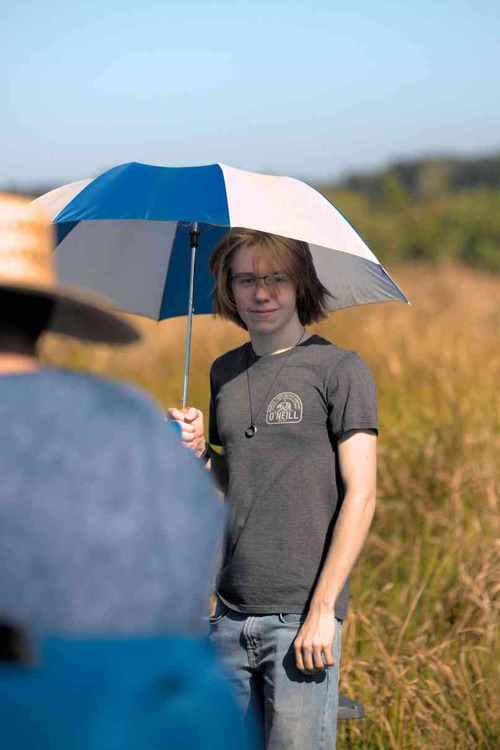

  

  I am a computer science student at the University of Central Florida. I am highly passionate about software engineering, and particularly enjoy working with embedded systems and studying programming languages.

  I am currently an intern at [Moog Inc.](https://www.moog.com/) where I work on several different projects, including software for embedded systems, GUI development, and developer operations improvements. In particular, I developed a fully automated hardware integration test suite for an embedded system, which improved and formalized the testing process.

  My first hands-on experience with embedded systems was during my time at [Knights Experimental Rocketry](https://kxrucf.com/) as a backend lead for Launch Test Infrastructure, where I developed and designed a modular backend for real-time sensor streaming and remote command execution. This involved building an embedded C solution on a Xilinx FPGA utilizing a Zynq 7020, and collaborating with various teams for integration purposes.

  I also enjoy exploring the nuances of programming languages and compilers. My current work with the [APPLeSEEd Lab](https://paulgazzillo.com/research/) focuses on the semantic analysis and translation of C preprocessor macros. Specifically, I have been developing [MerC](https://github.com/appleseedlab/merc), a tool that translates C preprocessor macros into proper language constructs.

  Outside of work, I'm a dedicated Linux user and enjoy contributing to open source projects or my own pet projects.
  

  

  
  

